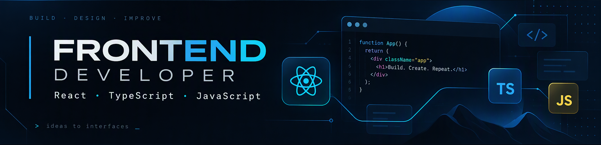

  

  
  

---

## Sobre mí

Frontend Developer enfocado en React y TypeScript. Desarrollo interfaces web modulares, integradas con APIs REST y orientadas a mantenibilidad, rendimiento y experiencia de usuario. Experiencia trabajando con testing, gestión de estado y desarrollo guiado por especificaciones.

---

## Stack

**Frontend**  

**Estado, datos y formularios**  

**Testing**  

**Complementarias**  

---

## Proyectos destacados

- **[DentDesk](https://github.com/Davico84/DentDesk)**  
  Software odontológico multi-clínica en desarrollo (historia clínica, odontograma, pacientes y personal). Frontend en React 19 y TypeScript organizado por módulos de dominio, con TanStack Query, Zustand, React Hook Form + Zod y cliente de API generado con orval desde un contrato OpenAPI. Pruebas con Vitest, Testing Library, MSW y Playwright; CI en GitHub Actions; desarrollo guiado por especificaciones con OpenSpec. Probado solo con datos de prueba.

- **[HSFACOP](https://github.com/Davico84/HSFACOP)**  
  Sistema de historias clínicas de ortodoncia: formulario por pasos con autoguardado, listado con búsqueda, impresión y roles de usuario. Mismo enfoque técnico que DentDesk: React, TypeScript, Tailwind CSS, TanStack Query, Zustand, contrato OpenAPI, pruebas automatizadas y OpenSpec.

- **[PFVideojuegos-Front](https://github.com/Davico84/PFVideojuegos-Front)**  
  Proyecto final grupal del bootcamp de Henry: app móvil de videojuegos con React Native (Expo), Redux Toolkit, Axios y Formik. Incluye carrito, perfil de usuario y cambio de idioma y tema.

- **[BurbujasCoinDPT](https://github.com/Davico84/BurbujasCoindPT)**  
  SPA con React, TypeScript, Vite y Tailwind CSS para visualizar datos de monedas con D3 y Chart.js.

- **[GymReminderAdmin](https://github.com/Davico84/GymReminderAdmin)**  
  Panel de administración con React, Vite y Material UI: dashboard con gráficos, clientes y registro de eventos.

- **[ProyectoIndividualVideoGames](https://github.com/Davico84/ProyectoIndividualVideoGames)**  
  SPA de videojuegos con React y Redux que consume la API de RAWG: búsqueda, filtros, ordenamiento, paginado, detalle y alta de videojuegos. API propia con Node, Express, Sequelize y PostgreSQL.

---

## GitHub

  

